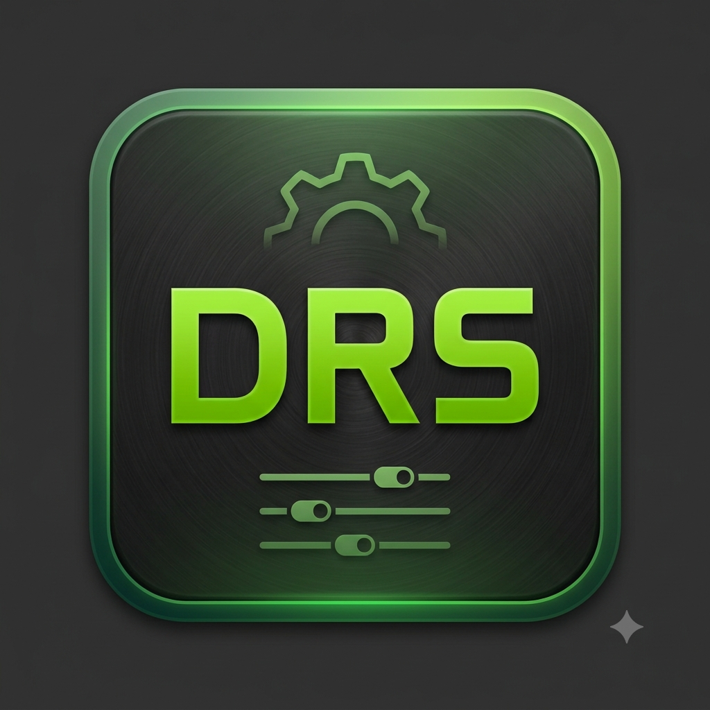

# DRSTool

> ⚠️ **Use at your own risk.** DRSTool changes GPU driver settings and, optionally, system tuning parameters. Read [DISCLAIMER.md](DISCLAIMER.md) before using it.

**DRSTool** is a PySide6 (Qt6) GUI for configuring [dxvk-nvapi](https://github.com/jp7677/dxvk-nvapi) and the NVIDIA DRS (Driver Registry Settings) profile, plus a set of environment-variable builders for Wine, Proton, DXVK, VKD3D-Proton, Gamescope and NVIDIA-specific tuning. It can write the result straight into a Lutris, Steam, Heroic or Bottles game config, a `dxvk.conf` or a standalone launcher, and includes diagnostics (linter, live process check, log viewer, frametime analysis) to verify that the settings actually work.

Turkish version: [README.tr.md](README.tr.md)



## Components

| Component | Path | Description |
|---|---|---|
| DRSTool GUI | `DRSTool.py` | Main application: DRS settings, environment variables, Gamescope flags, profiles, launcher sync, diagnostics |
| vk_flip_meter (FLM) | `vk-flip-meter-main/` | Vulkan implicit layer for frame pacing on VRR panels and a precise FPS limiter. See its [README](vk-flip-meter-main/README.md) |
| lutris-game-tune | `lutris-game-tune-main/` | Pre/post-game system tuning for Lutris, CCD/CCX core isolation, and lower-nice game startup (setuid C wrapper + Bash) |
| Ebuild | `drstool-9999.ebuild` | Gentoo live ebuild (`games-util/drstool`) that builds and installs all of the above |

## Features

### DRS Settings
- NVIDIA DRS settings with descriptions, grouped by category
- GPU architecture selector (sets `DXVK_NVAPI_GPU_ARCH`)
- Preview of the resulting command/environment before applying

### Environment Variables
The Environment tab covers 238 variables in these groups:

- **DXVK** (incl. `DXVK_HUD` flag grid and the `DXVK_CONFIG` key picker)
- **DXVK forks**: d7vk, dxvk-low-latency, DXVK-Sarek (each labelled with the Proton fork it belongs to)
- **VKD3D-Proton** (`VKD3D_CONFIG` checkbox grid, plus debug/profile variables)
- **DXVK-NVAPI** (DRS settings, Vulkan Reflex layer, logging, NGX debug options)
- **Proton** and **Wine**, including Proton-GE, Proton-EM, Proton-CachyOS and Proton-DW specific flags
- **NVIDIA** `__GL_*` and `__NV_*` variables, PRIME / hybrid-GPU settings
- **NVIDIA Smooth Motion** (NVPresent layer)
- **Wayland input** flags and non-AMD game-optimization flags

Variables that take a fixed set of values are shown as checkboxes or dropdowns; free-form values are text fields.

### Gamescope
Builds `gamescope` command lines from a flag catalog (upscaling, frame pacing, input, session options).

### Navigation and everyday helpers
- **Ctrl+K** searches every DRS setting, environment variable, GPU architecture and tool page; **Ctrl+F** filters the current list; **Ctrl+1…5** switches the top tabs; **Ctrl+D** toggles a favorite; **Ctrl+S** saves the current profile
- "Only set" and "Favorites" chips narrow the lists to what is configured or starred
- The **Lint** button checks the whole configuration for combinations that contradict each other (see Linter below). It also knows DRS: Multi-Frame Generation on a pre-RTX 50 card, Frame Generation before RTX 40, DLSS on a GTX, a GPU-arch spoof that is newer than / identical to the real card, DLSS-SR Scaling without Custom mode, DLSSG Dynamic-only settings, Smooth Motion stacked on Frame Generation
- **Undo / redo** (Ctrl+Z, Ctrl+Shift+Z / Ctrl+Y, ↶ ↷ in the top bar): every change to DRS settings, arch, env vars and gamescope is one step — profile loads, imports, recipes, lint fixes and *Reset* included. Typing in one field collapses into a single step. The arrow next to Undo lists the last 30 steps; click one to jump there
- **Unsaved-changes marker is exact**: it compares the editor with the saved profile, so undoing back to the saved state clears it. Click the profile name in the top bar to see the diff and *Revert to saved*
- **Import a launch line** (Ctrl+Shift+V, the Copy-all ▾ menu, or drop text on the window): paste Steam launch options, a shell snippet, `export` lines or a bare `DXVK_NVAPI_DRS_SETTINGS` value. It decodes DRS pairs (any number spelling), the GPU arch, `env -u`, gamescope flags and `mangohud`; converts `prime-run` and `strangle N` to their env equivalents; reports wrappers and game arguments it leaves out. A checkable preview shows +new / ~change / =same per item, Merge or Replace, and a **lint forecast** of the result before you apply
- **Explain the launch line** (Copy-all ▾ menu, Ctrl+K): the current output decoded token by token with catalog descriptions; *Copy explanation* gives a Markdown list to paste into a forum post
- **✦ Recipes** (Ctrl+R): curated bundles — DLSS newest models, force DLAA, Multi-Frame 4x, DLSS indicator, Reflex for Vulkan, Smooth Motion, HDR via Wayland or gamescope, fewer shader stutters, hybrid-laptop dGPU, NTSync, low-latency DXVK. Each shows whether this machine meets its requirement and how much of it is already applied, and opens the same preview + lint forecast. Recipe values are validated against the catalog at runtime
- Variables and DRS IDs outside the catalog (from imports or hand-edited profiles) get their own sidebar groups — *Custom (not in catalog)* / *Custom IDs* — so they stay editable and removable
- GPU Arch: the card in this machine is marked **◆ your GPU**, and the detail page says whether the chosen spoof is older, newer or identical

### Profiles
- Save and load full profiles (DRS settings + environment variables)
- Right-click a profile (or *More ▾*): Rename, Duplicate, Compare with editor, Export to file, Import from file (single-profile export or a whole `profiles.json`; name clashes get a suffix)
- XDG-compliant storage: `$XDG_CONFIG_HOME/drstool/` (default `~/.config/drstool/`), written atomically
- **History** (Profiles → History): every overwrite or delete of `profiles.json` keeps a snapshot (last 60) in `drstool/history/`. Browse snapshots, diff a profile against its live version, restore one profile or the whole file. A second sub-tab browses the `.bak` files written next to Lutris YAMLs (and Steam / Heroic / Bottles files) with a diff and one-click restore; a third compares any two profiles (or the current editor state)
- **Import .nip** (Profiles → Import .nip): converts an NVIDIA Profile Inspector export into `DXVK_NVAPI_DRS_SETTINGS` pairs and applies them to the editor (DWORD values only); known settings are recognised by name and their values are stored in the catalog spelling so the editor buttons light up
- **External changes**: if `profiles.json` or the selected Lutris YAML is modified outside DRSTool (another instance, a script, Lutris itself), a banner offers *Reload / Merge* (profiles) or *Refresh preview / Load into DRSTool* (Lutris). Detection is content-based, so DRSTool's own writes and a plain `touch` never raise it

### Launchers and sync
The sync tabs write the current configuration to wherever the game is started from. Every write keeps a timestamped backup.

| Tab | What it does |
|---|---|
| **Launch line** | A runnable `env … gamescope … -- <command>` line. Optional **umu-launcher** mode wraps the command as `umu-run <exe>` and adds `PROTONPATH` (GE-Proton / UMU-Latest / an installed Proton), `GAMEID`, `STORE` and `WINEPREFIX`. Can be saved as a shell script |
| **Lutris** | Reads and writes a game's YAML (`system.*` keys, env vars, Gamescope options, Lutris Game Tune commands) and imports it back ("Load from selected game"). Only keys DRSTool manages are changed; hand-written keys are preserved and the confirmation dialog lists everything that will be removed |
| **Steam** | Writes the launch options of an installed game into `localconfig.vdf` and, optionally, the **per-game Proton build** (`CompatToolMapping` in `config.vdf`): GE-Proton, Proton-CachyOS and official Valve builds are listed, "Steam default" removes the override. Steam must be closed; a read-back check runs before anything is written |
| **Heroic / Bottles** | Writes env vars and wrappers into the launcher's own per-game config |
| **dxvk.conf** | Turns the `DXVK_CONFIG` key picker into a real `dxvk.conf` in the game folder, or into `~/.config/drstool/dxvk/<name>.conf` plus `DXVK_CONFIG_FILE`. Hand-written lines are kept, DRSTool's keys live in one marked block, a diff is shown first. (vkd3d-proton has no config file; `VKD3D_CONFIG` stays an environment variable.) |
| **Shortcut** | Creates a standalone launcher script (`~/.local/share/drstool/launchers/`) and a `.desktop` entry, optionally through lutris-game-tune (PRE → RUN → POST). The script is a snapshot of the configuration at creation time |
| **History / Import .nip** | See Profiles |

### Extra Tools
**Build and tune**
- **vk_flip_meter**: edit FLM settings, live tuning (writes `FLM_CONFIG` and sends `SIGUSR1`)
- **lutris-game-tune**: edit the tuner config and the per-game Lutris settings
- **DLSS Updater**: list every DLSS SR / RR / FG and Streamline build on NVIDIA's NGX servers (incl. staged builds) and download the selected ones as `nvngx_dlss*.dll` / `sl.*.dll` into a version-named folder, SHA-256 checked
- **MangoHud** and **vkBasalt**: option builders for the overlay / post-processing config
- **Prefix Doctor**: compares the DXVK, vkd3d-proton and dxvk-nvapi DLLs in a Wine prefix with the latest GitHub release and replaces outdated ones (originals are backed up)

**Check and diagnose**
- **Linter**: finds combinations that contradict each other or cannot work on this system (e.g. `PROTON_NVIDIA_LIBS` with WoW64, FSR4 on NVIDIA, double latency stacks); many findings have a one-click fix
- **System**: NVIDIA driver, Vulkan devices, ntsync, session type and installed tools, probed once and shared with the Linter and the availability greying
- **Cache**: sizes of the NVIDIA GL/compute, Mesa, DXVK and vkd3d-proton caches (driver caches, Steam `shadercache/<appid>` in every library, Lutris per-game caches, paths from the Env Vars tab, folders you add), with open / clear actions. When the NVIDIA driver version changes the driver-bound caches are flagged as invalid
- **Upstream drift**: downloads the current DXVK, vkd3d-proton, dxvk-nvapi, gamescope sources and `NvApiDriverSettings.h` and lists env vars, `dxvk.conf` keys, `VKD3D_CONFIG` flags, gamescope CLI flags and DRS IDs that are new upstream or gone; rows can be marked as reviewed. Env var rows marked "gone" can also mean "removed in a newer version, still valid for forks or older builds"
- **Frametime**: MangoHud CSV logs and `FLM_CSV` dumps: average FPS, 1% / 0.1% lows, percentiles, stutter and hitch counts and a frametime graph. Load a second run to compare two configurations side by side (B vs A in %)
- **Live process**: pick the running game and compare the environment DRSTool is configured to set with what the process really received (`/proc/<pid>/environ`: ✔ match / ≠ differs / ✗ missing). Also lists the DXVK, vkd3d-proton, dxvk-nvapi, NGX / Streamline DLLs and Vulkan layers mapped into it and warns when DRS settings are configured but no NVAPI DLL is loaded
- **Logs**: Proton (`steam-<appid>.log`), DXVK and vkd3d-proton log viewer with severity filters, search and follow mode. Recognises common failures (NVAPI missing, nvcuda, GPU device lost, out of memory, ntsync, esync file-descriptor limit, Vulkan device/extension errors, NGX, missing DLL imports) with a hint and, where it is safe, a one-click fix. "Enable logging vars" sets `PROTON_LOG`, `PROTON_LOG_DIR` and `DXVK_LOG_PATH`
- **Game hints**: look up a Steam appid and get suggestions from three sources, each labelled in the *Source* column:
  1. *heuristic*: simple rules on the game's graphics API (e.g. `PROTON_ENABLE_NVAPI=1` for Direct3D 11/12 on NVIDIA)
  2. *system*: derived from this machine (ntsync device present, hybrid NVIDIA + iGPU → PRIME offload variables, Wayland session)
  3. engine and **ProtonDB tier** notes: Unreal / Unity / native-Vulkan / D3D9-era remarks, and which Proton build to try (stock Proton for gold/platinum, Experimental or GE-Proton for silver, GE-Proton / Proton-CachyOS or an older Valve build for bronze/borked, regression and improvement hints from the trending tier, plus the builds you already have installed)

  Only variables that exist in DRSTool's catalog are ever suggested, values already set are skipped, and results are cached for a week.

  **Games that are not on Steam** (Lutris, Heroic, Bottles, manual): type the game's name, or pick it from your launchers, and *Find appid* searches the Steam store and lists matches with a similarity score. *Use selected appid* runs the lookup; *Use + set as umu GAMEID* also fills the Launch line tab's `GAMEID` with `umu-<appid>`. A game that is not sold on Steam simply has no match (use `umu-0`).
- **Community tips ⚠**: the environment settings that ProtonDB *user reports* mention, kept on their own tab on purpose. Every mention is listed, even if only one report has it, together with the reporter's GPU and driver, Proton build, OS and kernel, verdict and report date (hover a row for CPU and RAM). Filters: NVIDIA reports only, last 6 / 12 months, and "only variables DRSTool can set"; a *Seen* column shows how many reports use the same setting. The data comes from ProtonDB's public monthly report dump (github.com/bdefore/protondb-data, ODbL): press *Download / update ProtonDB report data* once (~70 MB, indexed locally in a few seconds, last 12 months kept) and every game is then searched offline. Compare the reporter's setup with yours before trying anything. **Use at your own risk**: these are individual experiences that DRSTool has not verified; they can behave differently on other hardware, drivers, kernels, Proton builds and Linux setups and may cause crashes or lower performance. Nothing is preselected, the Apply button stays disabled until you tick an acknowledgement, and a confirmation dialog repeats the warning. Variables that are not in DRSTool's catalog are shown for information only

### Lutris notes
Lutris writes to its own config as well; if you edit a game in both places, use the external-change banner (above) and *Load from selected game* to bring DRSTool back in sync.

### Network access
Most of DRSTool works offline. These features contact the internet only when you press their button: **Upstream drift** (GitHub raw files), **Prefix Doctor** (GitHub releases), **DLSS Updater** (NVIDIA NGX servers), **Game hints** (ProtonDB summary and PCGamingWiki), **Community tips** (the ProtonDB report dump from GitHub raw files, ~70 MB, only when you press its download button).

### Where DRSTool keeps its files
| Path | Content |
|---|---|
| `~/.config/drstool/profiles.json`, `history/` | profiles and their snapshots |
| `~/.config/drstool/dxvk/` | `dxvk.conf` files created in "config dir" mode |
| `~/.local/share/drstool/launchers/` | scripts created by the Shortcut tab (the `.desktop` files go to `~/.local/share/applications/drstool-*.desktop`) |
| `~/.cache/drstool/hints/`, `~/.cache/drstool/logs/` | Game hints cache; logs written when "Enable logging vars" is used |
| next to edited files | timestamped `.bak` copies |

(`XDG_CONFIG_HOME`, `XDG_DATA_HOME` and `XDG_CACHE_HOME` are honoured.)

## Requirements

- Linux with an NVIDIA GPU and the proprietary driver (for DRS settings)
- Python 3.12+
- PySide6
- Optional, for specific features: Lutris, Gamescope, Proton/Wine, a Vulkan SDK + CMake (to build FLM)

## Running from source

```bash
pip install PySide6
python3 DRSTool.py
```

## Installing on Gentoo

The included ebuild (`drstool-9999.ebuild`) is a live ebuild that pulls from git.

USE flags:

| Flag | Default | Effect |
|---|---|---|
| `flip-meter` | on | Build and install the vk_flip_meter Vulkan layer (C++) |
| `lto` | off | Build the layer with `-flto` (requires `flip-meter`) |
| `pgo` | off | Two-pass profile-guided optimization for the layer (requires `flip-meter`) |
| `lutris-tune` | on | Install the lutris-game-tune setuid wrapper, script and default config |

```bash
emerge --oneshot games-util/drstool
```

Note: lutris-game-tune requires the setuid-root wrapper. The ebuild sets it up; check it with `lutris-game-tune-wrapper STATUS`.

## Usage notes

- Changes are applied to the selected game's configuration. Read the preview before writing.
- Settings are written to disk; they take effect on the next game launch. lutris-game-tune changes apply on the next PRE run.
- Before every write to a Lutris config, DRSTool creates a timestamped `.bak` copy next to it and keeps the most recent 5.

## Project layout

```
DRSTool.py                 main GUI
assets/drstool.png         application icon
drstool-9999.ebuild        Gentoo ebuild
vk-flip-meter-main/        FLM Vulkan layer (C++, CMake)
lutris-game-tune-main/     Lutris tuner (Bash + setuid C wrapper)
DISCLAIMER.md              risk notice
LICENSE                    MIT
```

## License

MIT. See [LICENSE](LICENSE).

## Disclaimer

This project was developed with AI assistance. It is provided without warranty. See [DISCLAIMER.md](DISCLAIMER.md) for the full text.
